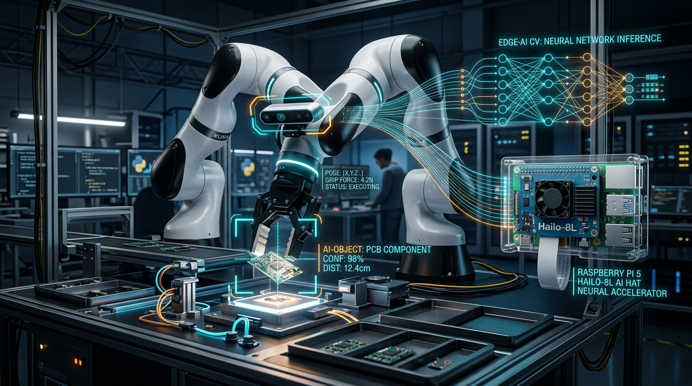
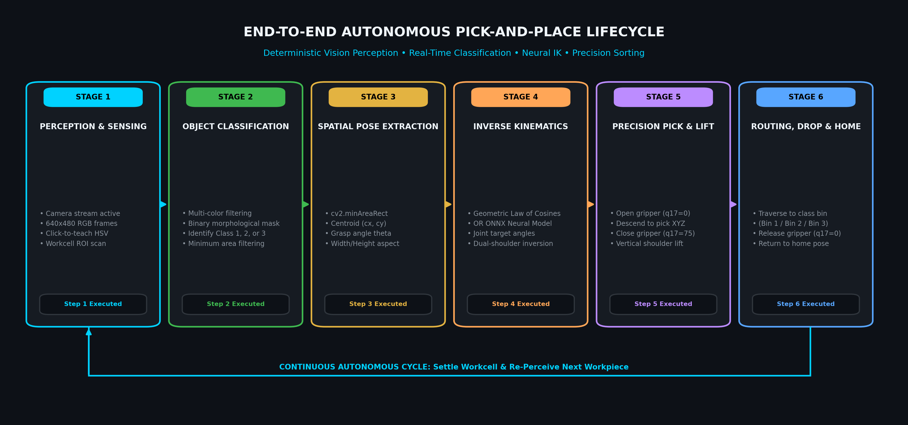
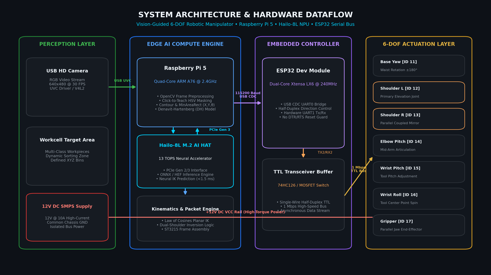
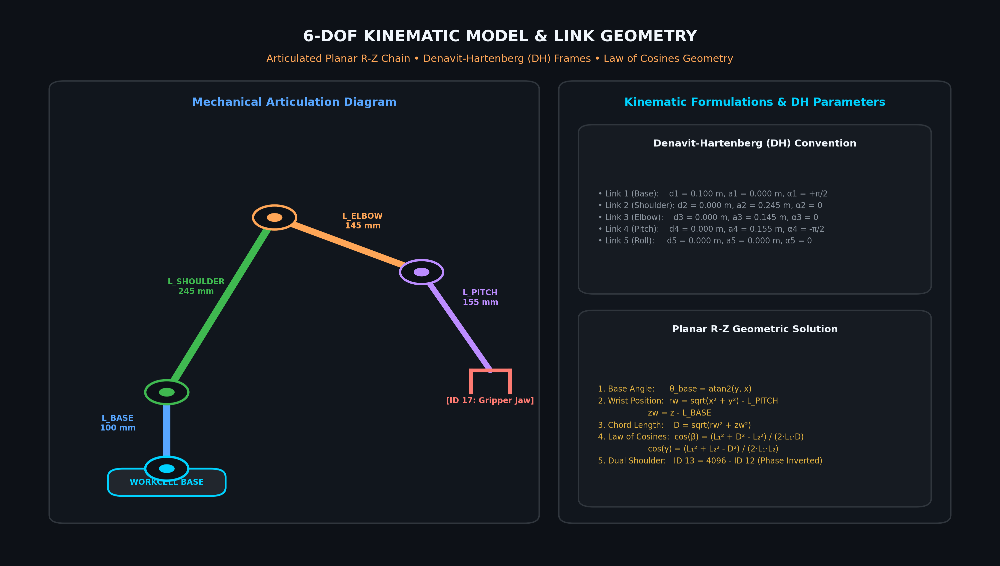
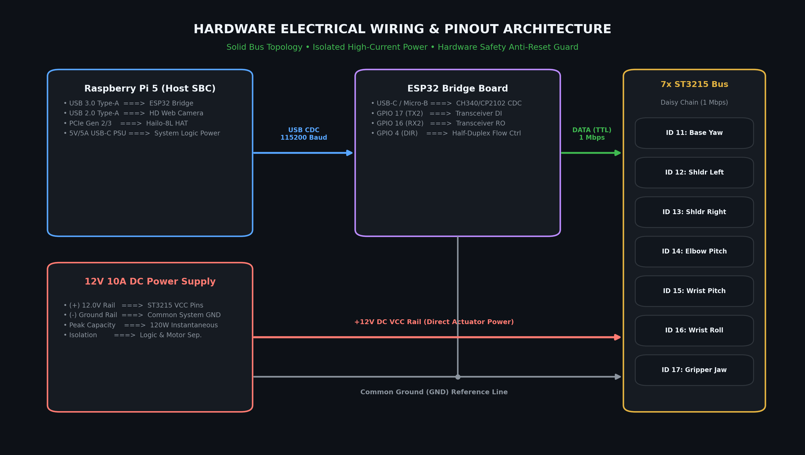

# 🤖 Autonomous 6-DOF Robotic Manipulator with Edge AI Vision & Neural Kinematics



<div align="center">

[](https://www.raspberrypi.com/)
[](https://hailo.ai/)
[](https://www.espressif.com/)
[](https://www.waveshare.com/)
[](https://www.python.org/)
[](https://pytorch.org/)
[](https://opencv.org/)
[](LICENSE)

</div>

---

## 📌 Executive Overview

The **ST-RobotArm** is a production-grade, vision-guided **6-DOF robotic manipulator** engineered for autonomous multi-class object detection, real-time semantic identification, spatial pose extraction, and closed-loop pick-and-place sorting.

Driven by a **Raspberry Pi 5** paired with a **Hailo-8L AI Acceleration HAT (13 TOPS)** and an **ESP32 Serial Motor Driver**, this architecture unifies edge intelligence with high-torque industrial bus actuation. It features a **dual-shoulder parallel torque architecture** driven by high-torque **Feetech / Waveshare ST3215** serial bus servos (12-bit magnetic contactless absolute encoders, 4096 steps/rev), analytical Denavit-Hartenberg (DH) forward kinematics, geometric closed-form inverse kinematics (IK), and a lightweight neural surrogate model trained for sub-millisecond Cartesian-to-Joint trajectory generation.

---

## 🔄 End-to-End Autonomous Pick-and-Place Lifecycle



The system executes a deterministic closed-loop autonomous manipulation workflow:

1. **Perception Acquisition**: Overhead USB camera activates and continuously acquires 640×480 RGB frames at 30 FPS across the workcell active zone.
2. **Object Detection & Classification**: Real-time HSV segmentation / AI inference identifies target items and classifies them into distinct operational categories (Class 1, Class 2, Class 3).
3. **Spatial Pose & Grasp Extraction**: The vision engine computes oriented minimum-area bounding boxes (`cv2.minAreaRect`), isolating centroid coordinates $(c_x, c_y)$ and planar orientation alignment angle $(\theta)$.
4. **Inverse Kinematics Solution**: Target $(x, y, \theta)$ coordinates are translated into physical 5-axis joint angles $[q_{11}, q_{12}, q_{14}, q_{15}, q_{16}]$ via analytical Law of Cosines or the ONNX neural surrogate model in <1.5 ms.
5. **Precision Pick & Clearance Lift**: Gripper opens ($q_{17}=0$), interpolates down to target workpiece pose, locks the gripper ($q_{17}=75$), and executes a vertical shoulder elevation (+25 mm) to guarantee collision-free travel.
6. **Class-Specific Routing & Drop**: Manipulator routes directly to the designated receptacle assigned to that specific object class (Bin 1, Bin 2, or Bin 3), releases the jaw ($q_{17}=0$), and returns to baseline safe Homing configuration.

---

## 🏛️ System Architecture & Dataflow Pipeline



The system is partitioned into four synchronized architectural tiers:

* **Perception & Workcell Layer**: USB HD web camera streaming UVC video, accompanied by an isolated 12V 10A DC regulated power delivery unit.
* **Edge Compute & AI Engine (Host SBC)**: Raspberry Pi 5 orchestrating the OpenCV vision pipeline, interacting with the Hailo-8L NPU over PCIe Gen 2/3 for neural acceleration, and computing real-time kinematic transforms.
* **Embedded Controller Layer (ESP32)**: Asynchronous serial driver acting as a high-speed bridge between host USB CDC (115200 Baud) and single-wire half-duplex TTL bus (1 Mbps), with hardware DTR/RTS suppression to prevent MCU resets.
* **6-DOF Actuation Layer**: 7x daisy-chained ST3215 serial bus servos delivering up to 30 kg·cm holding torque per joint with 12-bit magnetic encoder telemetry.

---

## ⚡ Core Engineering Features

* **🚀 13 TOPS Edge AI Inference**: Deploys deep vision models and neural inverse kinematics via the Raspberry Pi 5 and Hailo-8L M.2 AI HAT, reducing inference latencies to under 2 ms.
* **🦾 Dual-Shoulder Parallel Torque Architecture**: Joint 2 (Shoulder) is driven by two mirrored ST3215 servos (IDs 12 and 13) coupled mechanically in parallel. The firmware applies complementary phase inversion (`ID13_steps = 4096 - ID12_steps`), doubling shoulder payload capacity and preventing joint backlash under cantilever loads.
* **📐 Dual Kinematics Engine**:
  * **Analytical Geometric IK**: Closed-form mathematical solution utilizing planar Law of Cosines for boundary-checked, deterministic Cartesian-to-Joint mapping.
  * **Data-Driven Neural Network IK**: Multi-Layer Perceptron (MLP) network trained on physical workcell poses (`train_onnx_v2.py`) exported to optimized ONNX computational graphs (`ik_model_v2.onnx`).
* **🎯 Precision Computer Vision Pipeline**:
  * Interactive Click-to-Teach HSV color calibration (`color_detect_rr.py`, `smart_random_sorter.py`).
  * Oriented bounding box extraction (`cv2.minAreaRect`) computing centroid $(x, y)$, width, height, and grasp alignment angle $(\theta)$.
  * Multi-zone scan gates and multi-class dynamic bin sorting (Channels 1, 2, 3 $\rightarrow$ Bins 1, 2, 3).
* **🎓 Kinesthetic Lead-Through Teaching Mode**: De-energizes servo holding torque dynamically (`rec_replay.py`), enabling an operator to physically hand-guide the 6-DOF arm through complex trajectories, capture waypoints, and replay them with fine-tuned motor speeds and inter-waypoint delays.
* **✋ Contactless MediaPipe Gesture Teleoperation**: Integrated WebSocket client (`mec_ges.py`) tracking 21 3D hand landmarks via Google MediaPipe Hands to teleoperate the arm and robotic base over low-latency wireless networks.
* **🛡️ Industrial Serial Safety & Anti-Reset Guard**: Serial initialization routines explicitly suppress DTR and RTS toggles (`ser.dtr = False`, `ser.rts = False`), eliminating hardware resets on ESP32/CH340/CP2102 chips upon port acquisition.

---

## 📐 Kinematic Specifications & Link Geometry



The robotic arm operates under an articulated 5-axis plus end-effector kinematic model:

$$\vec{P}_{\text{wrist}} = \begin{bmatrix} X \\ Y \\ Z - L_{\text{base}} \end{bmatrix} - L_{\text{pitch}} \begin{bmatrix} \cos(\theta_{\text{base}}) \\ \sin(\theta_{\text{base}}) \\ 0 \end{bmatrix}$$

### Denavit-Hartenberg (DH) Parameter Table

| Link $i$ | Joint Angle $\theta_i$ | Link Offset $d_i$ (m) | Link Length $a_i$ (m) | Link Twist $\alpha_i$ (rad) | Home Offset (deg) |
| :---: | :---: | :---: | :---: | :---: | :---: |
| **1 (Base)** | $q_1$ | $0.100$ | $0.000$ | $+\pi/2$ | $0.0^\circ$ |
| **2 (Shoulder)** | $q_2$ | $0.000$ | $0.245$ | $0.000$ | $0.0^\circ$ |
| **3 (Elbow)** | $q_3$ | $0.000$ | $0.145$ | $0.000$ | $+180.0^\circ$ |
| **4 (Wrist Pitch)** | $q_4$ | $0.000$ | $0.155$ | $-\pi/2$ | $+90.0^\circ$ |
| **5 (Wrist Roll)** | $q_5$ | $0.000$ | $0.000$ | $0.000$ | $0.0^\circ$ |

---

## 🔌 Hardware Pinout & Wiring Architecture



### Signal & Electrical Mapping

| Source Component | Source Pin / Header | Target Component | Target Pin / Header | Protocol / Signal Type |
| :--- | :--- | :--- | :--- | :--- |
| **Raspberry Pi 5** | USB 3.0 Type-A | **ESP32 Bridge** | USB Type-C / Micro-B | USB CDC Serial (115200 Baud) |
| **Raspberry Pi 5** | USB 2.0 Type-A | **USB Web Camera** | USB Cable | UVC Video Stream |
| **RPi 5 PCIe Slot** | 16-Pin FPC Ribbon | **Hailo-8L HAT** | M.2 Key-M Slot | PCIe Gen 2 / 3 x1 Line |
| **ESP32 Board** | GPIO 17 (TX2) | **74HC126 / Transceiver** | Data Input (DI) | Half-Duplex TTL Logic |
| **ESP32 Board** | GPIO 16 (RX2) | **74HC126 / Transceiver** | Data Output (RO) | Half-Duplex TTL Logic |
| **Servo Driver Bus** | 3-Pin JST Header | **ST3215 Servo #11..17** | 3-Pin Input Port | Bidirectional Half-Duplex Serial |
| **12V DC Supply (+)** | Positive Rail (Red) | **ST3215 Bus Power** | VCC Pin (Pin 1) | 12.0V DC (Up to 10A peak) |
| **12V DC Supply (-)** | Return Rail (Black) | **ST3215 Bus Ground** | GND Pin (Pin 2) | Common Logic & Motor Ground |

---

## 📦 Bill of Materials (BOM)

| Category | Component | Description / Specifications | Interface / Protocol | Qty |
| :--- | :--- | :--- | :--- | :---: |
| **Compute** | Raspberry Pi 5 | Quad-Core ARM Cortex-A76 @ 2.4GHz, 8GB LPDDR4X | PCIe Gen 2/3, USB 3.0, Ethernet | 1 |
| **AI Co-Processor** | Hailo-8L M.2 HAT | 13 TOPS INT8 Edge AI Neural Network Accelerator | PCIe via RPi 5 M.2 HAT+ | 1 |
| **Microcontroller** | ESP32 Dev Module | Dual-Core Tensilica Xtensa 32-bit LX6 @ 240MHz | USB-UART (115200) / TTL Bus (1M) | 1 |
| **Actuators** | Waveshare ST3215 | High-Torque Serial Bus Servo (30 kg·cm @ 12V, 12-bit magnetic encoder) | Half-Duplex Asynchronous Serial | 7 |
| **Optics** | USB HD Web Camera | 1080p / 720p 60/30 FPS Wide-Angle CMOS Camera | USB 2.0 (UVC Standard) | 1 |
| **Power Supply** | 12V DC SMPS Adapter | 12V DC, 8A–10A Regulated Switching Power Supply | 5.5×2.1mm DC Barrel Jack | 1 |
| **Chassis** | 6-DOF Aluminum Arm | High-rigidity CNC Aluminum alloy structural links + parallel gripper | Mechanical Mounting Hardware | 1 |
| **Wiring** | Bus Harnesses | 3-Pin JST-XH (VCC, GND, DATA) Serial Daisy-Chain Cables | 2.54mm Pitch | 1 Set |

---

## 📡 ST3215 Serial Bus Communication Protocol

Communication with each servo occurs over a single-wire half-duplex UART bus at 115,200 baud (or 1,000,000 baud in direct hardware drive mode).

### Packet Frame Structure

$$\text{Packet} = \big[ \texttt{0xFF}, \texttt{0xFF}, \text{ID}, \text{Length}, \text{Instruction}, \text{Address}, \text{Data}\dots, \text{Checksum} \big]$$

$$\text{Checksum} = \sim\left( \sum (\text{ID} + \text{Length} + \text{Instruction} + \text{Address} + \text{Data}) \right) \ \& \ \texttt{0xFF}$$

### Primary Control Registers

| Register Address | Name | Data Type | Description |
| :---: | :---: | :---: | :--- |
| `0x28` (`40`) | `SMS_STS_TORQUE_ENABLE` | 1 Byte | `1` = Torque Locked; `0` = Free Hand-Guiding (Teaching Mode) |
| `0x2A` (`42`) | `SMS_STS_GOAL_POSITION` | 2 Bytes (L, H) | Target Position in ticks ($0 \dots 4095 \rightarrow 0^\circ \dots 360^\circ$) |
| `0x2E` (`46`) | `SMS_STS_GOAL_SPEED` | 2 Bytes (L, H) | Maximum joint movement speed (steps/sec) |
| `0x38` (`56`) | `SMS_STS_PRESENT_POSITION` | 2 Bytes (L, H) | Current 12-bit magnetic encoder feedback position |

---

## 📁 Repository Directory Structure

```
ST-RobotArm/
├── assets/
│   ├── banner.png                  # High-tech repository banner visual
│   ├── system_architecture.png     # Full system architecture & dataflow diagram (PNG)
│   ├── manipulation_lifecycle.png  # End-to-end 6-stage autonomous lifecycle diagram (PNG)
│   ├── kinematics_diagram.png      # 6-DOF link geometry & DH parameter diagram (PNG)
│   ├── hardware_wiring.png         # Hardware electrical wiring & pinout map (PNG)
│   ├── photos/                     # Physical hardware and workcell photo showcase
│   │   └── .gitkeep
│   └── videos/                     # Pick-and-place & gesture control demonstration clips
│       └── .gitkeep
├── Data_CO_Rec_Robo/
│   ├── drl_co_data_rec.py          # Vision-guided multi-color tracking & joint data collector
│   └── robot_home.csv              # Workcell zero/home coordinate calibration
├── Not_Req/                        # Experimental kinematics & archive files
│   ├── geo_ik.py
│   ├── gui_ijc.py
│   ├── kine_bwd.py
│   └── kine_fwd.py
├── pi/                             # Core Edge AI & Embedded Production Suite
│   ├── Data_Rec_Robo/
│   │   ├── drl_data_rec.py         # Autonomous reinforcement learning trajectory logger
│   │   ├── drl_data_rec_2.py       # Dual-stream visual feature & state logger
│   │   ├── drl_dataset_2.zip       # Pre-collected physical manipulation dataset
│   │   ├── drl_jinf.py             # PyTorch ResNet18 policy network real-time inference GUI
│   │   └── robot_model_v1.pth      # Pretrained visual-joint policy checkpoint
│   ├── color_detect_rr.py          # Interactive 3-channel color sorter GUI + servo sync
│   ├── geo_ik_motor.py             # Geometric IK solver with 10mm incremental step jogger
│   ├── geo_ik_motor2.py            # Comprehensive 6-DOF DH Forward & Geometric IK suite
│   ├── gui_ijc_2.py                # Interactive 6-joint slider controller with 4x4 DH FK
│   ├── ik_data_orientation.csv     # Orientation-augmented IK training dataset
│   ├── ik_inf.py                   # Lightweight ONNX Runtime random picker controller
│   ├── mec_ges.py                  # MediaPipe Hands 21-keypoint gesture controller (WebSocket)
│   ├── mec_ges_2.py                # Enhanced gesture teleoperation interface
│   ├── ml_data_collect_v2.py       # Data collector with oriented bounding box extraction
│   ├── ml_data_collector.py        # 2D centroid to joint coordinate training logger
│   ├── rec_replay.py               # Kinesthetic lead-through teaching & trajectory player
│   ├── requirements.txt            # Python edge runtime dependencies
│   ├── smart_random_sorter.py      # End-to-end ML pick + fixed-bin placement production app
│   ├── train_onnx.py               # PyTorch MLP training & ONNX model export (X, Y)
│   ├── train_onnx_v2.py            # PyTorch MLP training with orientation (X, Y, θ) -> 5 Joints
│   └── waypoints_color.csv         # Calibrated bin drop waypoints for sorting classes
├── tests/                          # Diagnostic & low-level hardware verification scripts
│   ├── test1.py                    # Bus ping scanner (detects connected ST3215 IDs 0-253)
│   ├── test2.py                    # Single-servo motion & feedback test
│   ├── test3.py                    # Dual-shoulder synchronous movement test
│   ├── test4.py                    # Safe DTR/RTS serial opening & torque validation
│   ├── test5.py                    # Continuous sinusoidal trajectory oscillation test
│   └── test6.py                    # Bi-directional read-after-write closed-loop position test
├── .gitignore                      # Git exclusion rules for build, binaries & caches
├── LICENSE                         # MIT Open-Source License
├── README.md                       # High-tech engineering documentation
├── robot_home.csv                  # Global calibrated safe home joint configuration
└── robot_home_pose.csv             # Global resting pose coordinates
```

---

## 💻 Installation & Setup

### 1. Embedded Hardware & Microcontroller (ESP32)

1. Connect the **ESP32 Serial Motor Driver Board** to your PC or Raspberry Pi via USB.
2. Verify that the ESP32 is flashed with the transparent UART-to-Half-Duplex bridge firmware (configured for 115,200 baud host rate).
3. Connect the 12V DC power adapter to the driver power terminals.
4. Run the hardware ping diagnostic to confirm all 7 bus servos are responding:
   ```bash
   python tests/test1.py
   ```
   *Expected console output: Servos detected at IDs 11, 12, 13, 14, 15, 16, and 17.*

---

### 2. Host / Raspberry Pi 5 Edge AI & Python Setup

#### A. Clone the Repository
```bash
git clone https://github.com/Programmer-Bose/ST-RobotArm.git
cd ST-RobotArm
```

#### B. Configure Python Virtual Environment
```bash
# Create an isolated Python 3.10+ environment
python3 -m venv venv

# Activate on Linux / Raspberry Pi OS:
source venv/bin/activate

# Or activate on Windows (PowerShell):
.\venv\Scripts\Activate.ps1
```

#### C. Install Core Runtime Dependencies
```bash
pip install --upgrade pip setuptools wheel
pip install -r pi/requirements.txt
```

#### D. Hailo-8L Edge AI Acceleration Setup (Raspberry Pi 5)
Ensure PCIe Gen 3 is enabled in `/boot/firmware/config.txt`:
```ini
dtparam=pciex1
dtparam=pciex1_gen=3
```
Install the HailoRT runtime and Python bindings:
```bash
sudo apt update
sudo apt install -y dkms hailo-all
pip install hailo-platform pyhailort
```

---

## 🚀 Execution & Usage Guide

### 1. Smart ML Object Sorter (`smart_random_sorter.py`)
Launches the end-to-end autonomous perception, classification, neural IK prediction, and fixed-bin placement pipeline:
```bash
cd pi
python smart_random_sorter.py
```
* **Workflow**:
  1. Click **Connect** to link to the ESP32 bridge.
  2. Click **Teach Color 1**, **Teach Color 2**, or **Teach Color 3** and click on workpiece items in the live video stream.
  3. Move the arm to teach target output Bin poses and click **Save Current Pose as BIN X**.
  4. Press **START ML SORTING** to execute full-speed autonomous sorting.

---

### 2. Interactive Color Sorter (`color_detect_rr.py`)
Runs color detection with dynamic scan gates and waypoint interpolation:
```bash
cd pi
python color_detect_rr.py
```

---

### 3. Kinesthetic Lead-Through Teaching & Replay (`rec_replay.py`)
Enables manual hand-guiding with zero motor resistance:
```bash
cd pi
python rec_replay.py
```
* Click **UNLOCK (FREE)** to de-energize servo torques.
* Move the physical arm by hand into the desired pose and click **📸 CAPTURE CURRENT POSITION**.
* Re-engage holding torque with **LOCK (HOLD)**.
* Click **▶ PLAY SEQUENCE** to repeat the recorded path at custom velocities.

---

### 4. Geometric & DH Kinematics Controller (`geo_ik_motor2.py`)
Provides interactive 3D Cartesian jogging ($X, Y, Z$) with real-time analytical Law-of-Cosines IK and 4x4 DH forward kinematics validation:
```bash
cd pi
python geo_ik_motor2.py
```

---

### 5. MediaPipe Gesture Controller (`mec_ges.py`)
Enables contactless, vision-driven 6-DOF teleoperation using hand landmark tracking:
```bash
cd pi
python mec_ges.py
```

---

## 🖼️ Media Showcases

### Physical Hardware & Workcell
High-resolution photographs of the physical robotic workcell, camera mount, and ESP32 driver:

| Workcell Overhead Setup | 6-DOF Robotic Arm & ST3215 Servos |
| :---: | :---: |
|  |  |

### Autonomous Manipulation in Action
Demonstrations of real-time perception, neural inverse kinematics, and sorting operations:

| Autonomous Pick & Place Demo | Kinesthetic Lead-Through Teaching |
| :---: | :---: |
|  |  |

---

## 🛠️ Diagnostics & Hardware Verification

The `tests/` directory provides comprehensive modular test scripts:

```bash
# 1. Scan bus for all active ST3215 IDs
python tests/test1.py

# 2. Test single servo movement and limit checks
python tests/test2.py

# 3. Verify dual-shoulder synchronized inverse motion (IDs 12 & 13)
python tests/test3.py

# 4. Safe DTR/RTS serial opening and torque holding verification
python tests/test4.py

# 5. Continuous sinusoidal oscillation trajectory validation
python tests/test5.py

# 6. Bi-directional read-after-write closed-loop position accuracy test
python tests/test6.py
```

---

## 🗺️ Roadmap & Future Developments

- [x] 6-DOF Analytical Geometric Inverse Kinematics.
- [x] Dual-Shoulder Synchronous Torque Mirroring.
- [x] PyTorch to ONNX Neural Inverse Kinematics surrogate pipeline.
- [x] Kinesthetic lead-through teaching with zero-torque mode.
- [x] Computer vision multi-class color segmentation and oriented bounding box extraction.
- [x] High-resolution PNG system architecture and hardware wiring diagrams with 100% solid lines.
- [ ] **Hailo-8L Native HEF Deployment**: Compile YOLOv8 / YOLOv11 nano/small models to Hailo Executable Format (`.hef`) for 100+ FPS object detection on RPi 5.
- [ ] **ROS2 Humble Integration**: Full `ros2_control` hardware abstraction layer with URDF model and MoveIt 2 motion planning.
- [ ] **RGB-D Depth Camera Fusion**: Integration with Intel RealSense D435 / Luxonis OAK-D for 6D object pose estimation ($X, Y, Z, \text{Roll}, \text{Pitch}, \text{Yaw}$).

---

## 📄 License

This project is licensed under the **MIT License** — see the [LICENSE](LICENSE) file for complete details.

---

<div align="center">
  <sub>Developed with precision by <b>Samim Akhtar (@Programmer-Bose)</b> • Engineered for Robotics & Edge AI Innovation.</sub>
</div>
